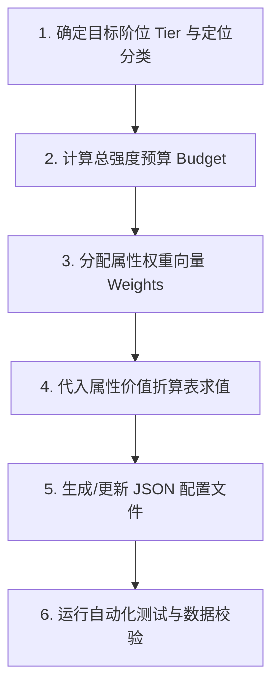

# 《道化太初》技能、装备、物品与 Buff 强度权重设计规范

## 1. 核心设计哲学与绝对红线

在《道化太初》中，**杜绝一切“拍脑袋填表、凭感觉填魔数”的配表行为**。所有战斗数值（技能、装备、消耗品、Buff、怪物）在配置文件中，**必须严格由【强度 (Intensity / Base Budget)】与【各属性权重 (Attribute Weights)】共同决定最终数值**。

### 1.1 核心公式
$$\mathbf{属性数值} = \mathbf{总强度预算 (Budget)} \times \frac{\mathbf{属性分配权重 (Weight)}}{\sum \mathbf{权重}} \times \mathbf{属性单位价值换算系数 (ConversionRate)}$$

### 1.2 绝对规则
1. **全量统一 `double` 精度**：所有数值计算与储存必须使用 `double` 类型，严禁整数截断导致的非预期突变。
2. **百分比统一存储为点数**：以 100 点 = 100% 当量（1 点 = 1%）作为基准，增减伤走 `Linear` 模式，CDR/攻速走 `NonLinear` 倒数模式。
3. **四独立乘区归一化**：$\text{最终面板} = \text{基础数值池 (BaseFlat)} \times (1 + \text{六维\%}) \times (1 + \text{装备\%}) \times (1 + \text{Buff\%})$。
4. **任何新增或修改配置均须给出完整的预算与权重推导过程**。

---

## 2. 统一属性价值换算常数表 (Unit Valuation Exchange)

所有强度预算（$1.0$ 点标准预算）在各属性间的等价折算常数：

| 属性大类 | 属性项 | 符号 | 1.0 点标准预算对应价值 | 换算公式 / 约束 |
| :--- | :--- | :--- | :--- | :--- |
| **生存池** | 最大生命值 | HP | **`12.0` 点** | $\Delta \text{HP} = 12.0 \times \text{Budget}$ |
| **能量池** | 最大灵力值 | MP | **`8.0` 点** | $\Delta \text{MP} = 8.0 \times \text{Budget}$ |
| **物理输出** | 物理攻击 | AD | **`1.0` 点** | $\Delta \text{AD} = 1.0 \times \text{Budget}$ |
| **术法输出** | 术法攻击 | AP | **`2.0` 点** (固定 2.0x 倾斜) | $\Delta \text{AP} = 2.0 \times \text{Budget}$ |
| **防御抗性** | 物理护甲 | Armor | **`1.0` 点** | $\Delta \text{Armor} = 1.0 \times \text{Budget}$ |
| **防御抗性** | 法术抗性 (水/木/火) | MRes | **`1.0` 点** | 单系抗性 $1.0$，全系三防各 $0.4$ (合计 $1.2$) |
| **对抗属性** | 命中 / 闪避 | Hit / Eva | **`1.0` 点** | 命中与闪避对抗点数 |
| **对抗属性** | 暴击 / 免爆 | Crit / CAvoid | **`1.0` 点** | 暴击与抗暴对抗点数 |
| **对抗属性** | 破招 / 拆招 | Break / Parry | **`1.0` 点** | 破招与化解对抗点数 |
| **百分比点数** | 增伤 / 免伤 | DmgRatio | **`1.0` 点 (1.0%)** | 线性加成点数 |
| **高级机制** | 穿透率 | Penetration | **`0.8` 点 (0.8%)** | 破甲/穿抗百分比 |
| **高级机制** | 伤害吸血 | LifeSteal | **`0.5` 点 (0.5%)** | 命中吸血比例 |
| **控制时长** | 眩晕 / 沉默 / 致盲 | CC Seconds | **`0.2` 秒** (按 100% 概率) | $1.0\text{s 控场} = 5.0\text{ 预算}$ |

---

## 3. 各模块强度与权重设计模型

### 3.1 技能设计模型 (Abilities)

每个技能的总强度预算 $B_{\text{skill}}$ 由**阶位基准预算 $B_T$**、**技能类型定位系数 $K_{\text{type}}$** 与 **技能强度乘区 $I_{\text{skill}} = 1.0 + (T-1) \times 0.30$** 决定：

$$B_{\text{skill}} = B_T \times K_{\text{type}} \times I_{\text{skill}}$$

#### 技能类型定位系数 $K_{\text{type}}$：
- **基础平A / 填充技 (0 CD)**：$K = 0.5$（需平摊到高频施法，单次伤害低）。
- **主力核心单体技 (CD 6~12s)**：$K = 1.0$。
- **长 CD 爆发 / 控制大招 (CD 15~20s)**：$K = 1.5$。
- **全屏 / 多目标群攻 (AoE)**：$K = 1.2$，单目标伤害需除以 $\sqrt{N_{\text{targets}}}$。

#### 技能预算分配权重项：
1. **伤害倍率权重 ($W_{\text{ratio}}$)**：转化为 `DamageRatio`。
2. **固定直伤权重 ($W_{\text{flat}}$)**：转化为 `FlatDamage`。
3. **控制机制权重 ($W_{\text{cc}}$)**：转化为 `Stun/Blind/Silence` 概率与秒数（消耗预算 = $\text{Chance} \times \text{Seconds} \times 5.0$）。
4. **特殊收益权重 ($W_{\text{special}}$)**：穿透（Penetration）、吸血（HpDrain）、护甲转化（ArmorDamage）。
5. **冷却与耗蓝修正**：
   - 耗蓝增加 $\to$ 返还额外预算（每 10 点 MP 补偿 $+0.8$ 预算）。
   - 吟唱时间长（CastTime $\ge 2.0$s）$\to$ 补偿 $+15\%$ 额外预算。

---

### 3.2 装备设计模型 (Equipment)

全套装备（6 大部位）提供与角色本体同等的 **1.0x 装备乘区增益**。

#### 槽位权重预算分配表：
| 部位 | 槽位权重占比 | 核心主属性倾斜权重 |
| :--- | :--- | :--- |
| **武器 (Weapon)** | **20.0%** | AD (40%), AP (40%), 命中 (10%), 破招 (10%) |
| **衣服 (Body)** | **20.0%** | 生命 HP (40%), 护甲 (30%), 法抗 (20%), 拆招 (10%) |
| **头盔 (Head)** | **15.0%** | 生命 HP (35%), 灵力 MP (35%), 护甲 (30%) |
| **下装 (Legs)** | **15.0%** | 生命 HP (40%), 闪避 (30%), 护甲 (30%) |
| **戒指 (Ring)** | **15.0%** | AD/AP (40%), 暴击 (30%), 命中 (30%) |
| **项链 (Neck)** | **15.0%** | 灵力 MP (40%), 免爆 (30%), 破招 (30%) |

#### 装备品质乘区（Quality Multipliers）：
- 凡品 (Q1): $1.0\times$
- 灵品 (Q2): $1.15\times$
- 玄品 (Q3): $1.35\times$
- 地品 (Q4): $1.60\times$
- 天品 (Q5): $1.90\times$
- 仙品 (Q6): $2.30\times$
- 神品 (Q7): $2.80\times$
- 混沌 (Q8): $3.50\times$

#### 强化成长公式（Enhancement Bonus）：
$$\text{单级强化增量 (EnhancementBonus)} = \frac{\text{基础属性 (BaseStats)}}{50.0}$$
（强化至 +20 满级时，总属性刚好翻倍 $+100\%$）。

---

### 3.3 消耗品与 Buff 设计模型 (Consumables & Buffs)

#### 消耗品预算换算：
- **瞬时恢复药（生命/灵力）**：$B = \text{Tier} \times 15.0$。转化为恢复量：$\Delta \text{HP} = B \times 12.0$；$\Delta \text{MP} = B \times 8.0$。
- **持续增益灵食/符箓（Buff）**：
  - 标准持续时长：300 秒（战斗灵饮/符箓）或 60~120 秒（挂机生产灵香/地火）。
  - 百分比增益预算：
    - 攻击/增伤 Buff：$+1.0\%$ 增益 $= 1.0$ 点预算。
    - 攻速/CDR Buff：$+1.0\%$ 点数 $= 1.2$ 点预算。
    - 生产产出倍率（采集/炼丹）：$+25\%$ 产出 $= 2.0$ 点预算；$+50\%$ 产出 $= 4.0$ 点预算。

---

### 3.4 怪物与遭遇设计模型 (Monsters & Encounters)

怪物无需人工填写独立孤立数值，必须对齐目标境界阶位 $T$ 的基准玩家：

$$\text{MonsterStats} = \text{BaselinePlayer}(T) \times \text{TierMultiplier} \times \text{TendencyWeights}$$

| 怪物层级 (Tier) | 全属性倍率 | 生命值 (HP) 倍率 |
| :--- | :--- | :--- |
| **普通妖修 (Normal)** | $1.0\times$ | $1.0\times$ |
| **精英大妖 (Elite)** | $1.2\times$ | $3.0\times \sim 3.6\times$ |
| **妖王首领 (Boss)** | $1.5\times$ | $10.0\times \sim 14.0\times$ |

---

## 4. 设计工作流程与步骤 (SOP)

当需要设计或修改一项技能、装备或 Buff 时，必须遵循以下步骤：



### 步骤详细说明：
1. **步骤 1（明确定义）**：确定目标所属阶位（Tier 1~12）、品质（Quality 1~8）以及流派风格（剑修/刀修/符箓/五行/炼体）。
2. **步骤 2（计算预算）**：查阅对应阶位标准预算底座（详见 [references/budget-tables.md](./references/budget-tables.md)），计算总预算 $B$。
3. **步骤 3（分配权重）**：列出该项实体的各项属性权重（如：`{ DamageRatio: 0.6, CC_Stun: 0.2, Penetration: 0.2 }`），确保权重总和为 1.0（或明确各自分配额度）。
4. **步骤 4（数值求解）**：将预算与权重相乘，乘以对应价值折算系数，得出具体配置参数（全部保留 `double` 精度）。
5. **步骤 5（写入配置）**：严格按照 `config/game-data/*.json` 的 Schema 写入。
6. **步骤 6（验证门禁）**：执行 `dotnet test`，确保无未知 ID 引用、无负数/非法概率值。

---

## 5. 快速推导案例

### 案例 1：设计 2 阶剑修爆发技能【惊鸿断空】
1. **阶位与定位**：第 2 阶（叩仙门），长 CD 绝杀技（CD 18s，耗蓝 50 MP）。
2. **强度预算**：
   - 阶位基准预算 $B_2 = 25.0$。
   - 大招系数 $K = 1.5$ $\to$ $B = 25.0 \times 1.5 = 37.5$。
   - 耗蓝补偿：50 MP 补偿 $+4.0$ 预算 $\to$ 最终总预算 $B_{\text{total}} = 41.5$。
3. **权重分配**：
   - 伤害倍率（DamageRatio）权重：$70\%$（预算 $29.05 \to$ 基础 1.0 + 增量 $0.80 = 1.80$ 即 $180\%$）。
   - 固定伤害（FlatDamage）权重：$20\%$（预算 $8.3 \to 8.3 \times 4.2 \approx 35$）。
   - 特殊破招暴伤联动：$10\%$（预算 $4.15 \to$ 破招时追加 $30\%$ 暴伤）。
4. **生成 JSON**：
   ```json
   {
     "id": "ability.jinghong-sever",
     "name": "惊鸿断空",
     "style": "sword",
     "damageType": "physical",
     "cooldownMilliseconds": 18000,
     "castMilliseconds": 500,
     "manaCost": 50,
     "damageRatio": 1.8,
     "flatDamage": 35,
     "damageRatioLevelBonus": 0.012,
     "flatDamageLevelBonus": 0.5
   }
   ```
