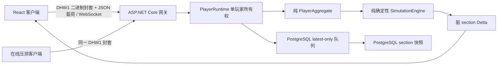

# 修仙行动队列游戏初步设计

状态：`v0.1`（历史底稿，部分段落已被后续设计与现行实现取代；现行权威口径以 [`总纲.md`](../../design/总纲.md) 及各专项文档为准）  
项目名称：道化太初  
技术基线：YuoCore + .NET 10 + ASP.NET Core + React 19

> **持久化权威性说明（2026-08-27）**：本文只定义玩法与交互边界；玩家存档、资产/市场事务、Outbox、日志/消息留存、容量与 Redis 选型统一以 [`docs/backend/commercial-persistence-architecture.md`](../../backend/commercial-persistence-architecture.md) 为唯一目标方案。当前内测直接使用 clean-room schema v1，不实现任何旧存档、旧协议或旧组件兼容层。

## 商业化界面与数值规则

- UI 只显示面向玩家的信息。开发说明、实现提示、功能解释和内部术语不得出现在正式界面。
- 基础属性固定显示；特殊属性仅在非零时显示。任何数值为 0 的特殊效果都必须完全无效，不能保留隐藏触发。
- 战斗角色区域保持固定比例和稳定尺寸，不得因为名称、日志、搜索或阶段变化扩展布局。
- 角色表现通过 `renderer/source/poster` 描述，当前支持文本与图片，后续可扩展 Live2D 和 3D。
- 生命、灵力、伤害、恢复、加成和百分比使用统一数值胶囊；技能和物品悬浮信息必须显示完整效果与具体数值。
- 生命归零即结算本次战斗失败并进入死亡状态。死亡玩家不能攻击、施法、使用物品或成为攻击目标；固定等待 180 秒读条完成后满生命、满灵力正式复活并重置技能与物品冷却，复活后重新搜寻且波次计数重置为 1。角色状态在世界中持续常驻：存活玩家脱战或取消队列时严格保留当前残余生命与灵力；处于死亡状态下主动取消战斗/脱战时，仅恢复至 1 点生命（1 HP）重伤复苏，并保留死亡期间自然回复的灵力，绝不一键回满。
- 物品槽只能选择当前库存中数量大于 0 的物品；技能槽只能选择服务端存档中已经习得的技能，目录存在不等于玩家拥有。

## 1. 产品方向

游戏是服务器权威的长线放置修仙游戏。玩家绝大多数成长行为都通过行动队列完成；修改队列、切换自动使用物品、聊天、设置等属于实时生效操作，不占用行动时间。

第一阶段只建立一条可验证、可离线补算的闭环：

```text
采摘凝血草（8 秒，产出 3 凝血草）
  → 炼制引气丹（12 秒，消耗 3 凝血草，产出 1 引气丹）
  → 引气入体（10 秒，自动使用引气丹，产出 10 修为与 1 灵力）
  → 循环
```

引气丹作为持续消耗品（详见 [`持续消耗品系统.md`](../../design/总纲/06-持续消耗品机制与生活制造体系.md)），在槽位中按动作实际耗时精准扣除持续时间（单件 300 秒），在生效期间为每次引气入体提供稳定的 +30% 修炼加成（修为由 10 提升至 13，灵力由 1 提升至 1.3），无需自然时间 Buff 计时器，亦不可叠层。

## 2. 操作模型

### 2.1 实时操作

实时操作立即校验、立即落库，不进入行动队列：

- 队列增删、排序和循环开关。
- 行动类型的自动使用物品槽配置。
- 在线、离线挂机、完全离线状态切换。
- 后续的聊天、市场挂单、社交和设置。

### 2.2 队列行动

每个行动由稳定 ID、类型、时长、输入和输出组成。初始类型为：

| 类型 | 初始行动 | 输入 | 输出 | 时长 |
| --- | --- | --- | --- | --- |
| 探索 | 采摘凝血草 | 无 | 3 凝血草 | 8 秒 |
| 炼丹 | 炼制引气丹 | 3 凝血草 | 1 引气丹 | 12 秒 |
| 修炼 | 引气入体 | 自动物品槽 | 10 修为、1 灵力 | 10 秒 |

行动队列具有以下约束：

- 只有队首行动推进；材料不足时进入 `blocked`，不会产生负库存。
- 重复次数支持无限或 `1..1,000,000`；循环开启时，一个条目的批次完成后保留原条目并移动到队尾。
- 条件不满足时，循环队列将该行动跳过一次并移动到队尾；非循环队列直接结束并移除该行动。整队均不可执行时，一次推进最多检查每个行动一次，避免空转。
- 队列状态只使用当前 `Entries` 表示；历史 `LoopTemplate` 模型不属于当前协议和存档格式。
- 自动使用槽属于行动类型而非单个行动，数据结构已经覆盖修炼、探索、炼丹和历练；物品目录按行动类型声明可用范围。
- 所有产出、消耗、Buff 和统计在同一结算边界完成，不允许客户端直接改数值。

## 3. 三种在线状态

| 状态 | 调度方式 | 队列推进 | 存储形态 | 重新进入时 |
| --- | --- | --- | --- | --- |
| 在线 | 下一事件截止时间 | 服务端在精确边界推进 | 聚合热状态 + 异步快照 | 增量同步 |
| 离线挂机 | 按需快进 | 按最后结算时间延迟推进 | 快照 + 按需休眠缓存 | 一次事件边界快进 |
| 完全离线 | 不调度 | 不推进 | 快照 + 排行榜投影 | 只更新时间基线，不追溯收益 |

服务端维护独立的在线玩家集合，并只计算其中最早的下一事件截止时间；队列或资源变化会发送唤醒信号并重新排程，不扫描离线账号。游戏时间使用单调时钟，快照、回收和市场维护由独立后台调度器执行，不能阻塞或推动战斗时间轴。离线挂机的收益采用惰性结算：玩家重新连接、被排行榜读取或后台批处理命中时，从 `LastSimulatedAt` 一次推进到目标时间。完全离线账号只影响账号存储和显式排行榜聚合，不参与行动计算。

## 4. 快进算法

快进不是逐秒循环，而是跳到下一次行动完成边界：

1. 检查并清理到期 Buff。
2. 若当前条目的批次完成且循环开启，将次数重置并把原条目移动到队尾。
3. 校验队首行动输入；不足则停止。
4. 计算完成时间；若超出目标时间，只写入剩余进度。
5. 到达边界后原子结算输入、输出、自动物品、Buff、统计和事件。
6. 重复直到目标时间或保护上限。

同一初始快照和目标时间必须得到完全相同的结果。测试会比较“一次快进一小时”和“逐秒推进一小时”的最终状态，这同时覆盖服务器停机一小时后的补算要求。

## 5. 服务端架构



关键边界：

- `Domain` 不依赖 Web、文件系统和 UI，便于确定性测试与未来拆分 Shard。
- 每个玩家聚合只能在其专属 `PlayerActor`（`PlayerRuntime` 持有）内修改；`SemaphoreSlim` 保证单写者串行语义，跨边界访问不直接持有聚合引用。
- 玩家 ID 经稳定哈希路由到固定运行时所有权单元，单元内部串行保持确定性。跨进程玩家所有权仍需额外网关路由。
- 在线截止时间使用带代际校验的最小堆维护；单个玩家状态变化只更新自己的截止时间，取下一事件和重新排程为 `O(log N)`，失效节点采用惰性清理并在膨胀阈值触发压缩。
- 持久化通过 PostgreSQL 的 section 快照、命令回执和 durable outbox 异步执行；同一玩家只保留最新待写 section，避免高频重复消息占用硬盘。
- 行动事件、实时命令和检查点只在真实结算边界进入持久化队列；两个事件之间的进度由时间戳确定性重建，不需要逐秒写盘。
- 单会话发送队列有容量上限；慢客户端溢出后标记重同步，下一次发送完整快照，不无限堆积内存。

## 6. 网络同步

连接建立时发送一次 `snapshot`；之后只发送带版本号的 `delta`。快照与 Delta 均按 `PlayerSectionKind` 七分段承载：

- `progression`：境界等级、修为与经验进度。
- `world`：保存地图、节点或边、边上进度、归一化坐标、地点行动集合、遭遇集合与修炼倍率。移动开始、路线边界和到达时下发权威位置，客户端依据时间锚点连续显示。
- `combat`：快照中包含流派、伤害类型、功法槽、通用消耗品槽和装备配置，并下发玩家当前生命、生命上限、当前灵力和灵力上限；资源跨遭遇、重新搜索和有限次数战斗结束持续保留，战斗结算仍只在服务端完成。
- `buffs`：活跃 Buff 增益/减益状态及到期时间。
- `loadout`：已装备物品实例与已领悟功法神通。
- `settings`：个人偏好设置（语言、通知、循环模式、快捷自动使用槽位）。
- `action_queue`：行动队列条目、队首进度与重复次数。
- `changedAssets`：本次结算发生变动的资产余额差量（灵石、物品等）。

静态目录统一经 `GET /api/v1/catalog/*` 下发（`actions`、`items`、`abilities`、`base-attributes`、`equipment`、`maps`、`encounters`）：地图目录返回节点、连线、通行时间、地点行动、遭遇、NPC 与建筑，遭遇目录返回加权敌群、强度限制、独立敌人属性和首领轮次；客户端的程序化山景只负责表现，不参与路径与位置计算。

普通行动只在开始、完成、被命令修改或其他真实事件边界发送状态；队列结构变化时发送完整 `action_queue` 分段，其余事件发送最小 Delta。客户端按区段合并，不替换整个页面。服务端包和在线压测均使用同一 DHW1 封套与 JSON 载荷，压测统计生产序列化后的真实包体。

日志同步采用“短快照 + 增量流”而不是反复发送完整列表：

- 结构化日志事件走独立 `LogBatchDto` 通道，服务端按玩家维护 200 条环形缓冲；
- 快照携带最近窗口的结构化记录（含稳定序号、毫秒时间戳和格式模板），增量只发送本次结算新增的事件；发送成功后立即释放，不建立无限待发历史。
- 日志格式模板使用 `{{类型:稳定ID|显示名称}}` 引用，例如 `{{item:item.qi-gathering-pill|引气丹}}`。首版支持 `item`、`character`、`mechanic`、`action` 和 `location`，客户端按结构化片段渲染，不解析或注入 HTML。

## 7. 前端连续性与适配

前端采用 Zustand 的顶层区段订阅。行动事件更新时，背包、搜索框、当前 Tab、聊天草稿和数量输入不会被重建。数量输入在获得焦点时保留本地草稿，仅在失焦或回车后提交，避免服务端状态同步覆盖正在输入的内容。

高频界面遵循以下实现约束：

- 顶部行动进度以服务端进度为锚点，通过 Web Animations API 在合成层连续推进；普通秒级补丁只检查漂移，误差在容许范围内时不重启动画、不写 DOM。
- 队首 Entry ID 变化时才触发约 180ms 的退场和晋位动画。队列进度更新不会触发任务卡重建动画。
- `Modal` 统一处理响应式宽度、遮罩、Escape、焦点圈定和焦点恢复；`ConfirmDialog`、行动详情等业务弹窗只组合内容。
- `QuantitySelector` 统一处理本地输入草稿、边界归一化、常用数量和无限次数，自动使用槽与行动弹窗复用同一实现。
- 物品卡只展示名称，左上角为类型、右上角为等级、右下角为数量；品阶不重复占用文字角标，由凡、黄、玄、地、天、灵、圣、帝八档统一颜色变量控制边框与背景。背包、行动详情和格式化日志共用 `ItemTooltipTarget` 展示来源、用途与持有量。
- 物品、功法、法器、流派和触发条件统一使用正方形选择槽；槽位点击后打开独立响应式网格弹窗，不使用原生下拉框。选择器基础样式集中在 `styles/selection-grid.css`。
- 桌面与移动布局同一时间只挂载一个日志面板，避免隐藏面板仍订阅高频日志。

### 7.2 历练地图与地点约束

- 历练页固定包含“地图、附近、斗法”三个子页；地图目录和玩家位置都以服务端状态为准。
- 地图节点使用非规则坐标和可斜向连接的无向边。客户端 SVG 仅绘制服务端目录，背景由固定种子在 Canvas 中生成，缩放时重绘且不进入 React 高频状态。
- 玩家选择目标节点后，服务端用 Dijkstra 规划完整路径，并把所有路段封装成唯一的 `world.travel` 队列行动，始终插入队首。普通队列行动保留原进度，移动完成后继续。
- 停止移动不会回滚到上一节点。存档保存当前 `EdgeId + EdgeProgress`；从边中间再次规划时，同时比较前往边两端的剩余时间，再选择总耗时更短的路线。
- 地点限制在入队和真正开始行动时各校验一次。循环队列遇到地点不符会跳过并移至队尾；非循环队列按既有规则结束该行动。
- 地点修炼倍率参与服务端最终修为收益计算，并作为地点 Buff 显示在顶部；探索行动和战斗遭遇从节点目录中筛选，移动途中不开放地点行动。
- “附近”首版展示当前节点的自己、NPC 与建筑静态目录；附近玩家可见性、玩家建筑权限和范围效果保留为后续服务端分片查询，不由客户端伪造。
- “斗法”采用固定尺寸双角色战场，首次搜索、交战和重新搜寻阶段不改变区域尺寸。角色区只显示名称、形象、生命、灵力和行动条；首次搜索与重新搜寻必须在顶部行动区和战斗区同步显示进度及倒计时，战斗事件统一进入底部日志。生命条减少部分向上裁切渐隐，灵力条减少部分向下裁切渐隐，所有资源增减都会显示漂字。

### 7.3 属性与界面文案规则

- 战斗属性全部使用明确数值参与服务端结算。暴击、免暴、伤害吸收、生命偷取、穿透、控制抗性等特殊效果不得用布尔开关或模糊状态代替；数值为 `0` 时必须完全不产生效果。
- 对抗概率统一采用标准除法公式计算（详见 [`战斗设计.md`](../../design/总纲/07-战斗数值与内视规约.md)）：优先判定守方闪避率 $\frac{\text{守方闪避}}{\text{守方闪避} + \text{攻方命中} + 100}$，未闪避即命中；暴击率为 $\frac{\text{攻方暴击}}{\text{攻方暴击} + \text{守方免爆} + 100}$（破招成功时暴击与命中效果翻倍）；暴击伤害为 $\text{基础伤害} \times \text{暴伤倍率}$（基础 150% + 暴伤加成）；自然自动回复读取基础属性表提供的独立回复属性 `HpRegen` 与 `MpRegen`，不在代码中按生命/灵力上限乘固定比例；生命 2% 仅为境界基础生命上限对应的配表参考，结算周期仍待讨论（见战斗规约 §9.2）。
- 角色属性分为基础属性和特殊属性。基础属性在角色详情中固定展示；特殊属性只在最终有效值不为 `0` 时展示。客户端只展示服务端投影或权威目录中的数值，不自行推导隐藏加成。
- 角色点击后打开独立属性弹窗。战场常驻区域只保留角色名、角色形象、生命、灵力、Buff 和行动条，不把完整属性塞入战斗主画面。
- UI 文案必须面向玩家当前可操作、可观察或可决策的信息。开发说明、实现解释、重复描述和“告诉玩家这个界面是什么”的辅助句不得进入正式 UI；设计每段文本时必须先判断它是否真正需要被玩家看到。
- 物品与功法的 hover 信息必须展示完整效果和具体数值。特殊效果为 `0` 时不展示对应条目，避免让玩家误以为零值仍有隐藏作用。
- 开发前端固定使用 `127.0.0.1:15172`，端口占用时直接失败，不允许自动更换端口。玩家身份由服务端 HttpOnly Cookie 会话确定；客户端不保存共享令牌或玩家存档副本。

布局分为三档：

- 宽屏：左侧导航、中央行动区、右侧背包、底部消息区，接近参考图的信息密度。
- 窄桌面/平板：左栏折叠为图标，中央与背包缩窄，面板各自滚动。
- 手机：行动、背包、消息三个常驻页面由底部导航切换，不发生横向溢出或面板重叠。

固定格式控件均设置稳定尺寸；动态数字使用紧凑格式；面板拥有明确的 `min-width: 0`、滚动容器和断点，不使用随视口缩放的字体。

### 7.1 客户端日志性能边界

- 日志不进入主 Zustand 游戏状态，避免高频日志连带刷新行动、背包和顶部状态。
- 新事件先在内存合并，视图通知按 80ms 合批；只保留最近 100 条内存记录，不写 IndexedDB 或其他浏览器历史库。
- `LogRow` 以稳定日志 ID 复用，并通过 CSS `contain` 隔离行级布局和绘制；超出环形缓冲的旧记录立即释放。
- 查看历史不触发服务端历史查询；客户端只展示当前内存窗口，重连后以服务端短快照重新建立窗口。

## 8. 性能验证方案

### 8.1 在线

- 建立指定数量的真实 `ClientWebSocket`。
- 每名玩家以相同节奏发送 `hello`、设置自动使用槽和循环开关；命令序列保持队列长度有界。
- 使用生产编码器统计发送/接收帧数与字节数，并读取服务端连接数、模拟版本和持久化队列水位。
- 首个正式基线目标为 500 人、持续 60 秒；应同时记录客户端与服务端 CPU、工作集和错误率。

### 8.2 离线挂机

- 默认创建 10,000 个与正式领域模型一致的玩家状态。
- 一次补算 3,600 秒，记录完成行动数、边界转换数、CPU、托管内存和工作集。
- 战斗场景使用正式暮影谷行动、加权多敌人、群攻功法、四类法器和 0-20 级强化，并额外记录完成遭遇、敌人击杀、战斗事件与在线待推送日志数量。
- 补算结果必须与逐秒推进一致，且复杂度与完成的行动边界数相关，而不是与离线秒数直接相关。

### 8.3 完全离线

- 默认创建 100,000 个账号状态。
- 调用同一推进入口验证完成行动和边界转换均为 0。
- 额外执行一次排行榜校验和，观察账号数量对显式聚合与内存的影响。
- 正式服不会为完全离线账号注册事件截止时间；排行榜应逐步迁移到独立投影和增量索引。

首轮实测数据见 [performance-baseline.md](../../backend/performance-baseline.md)。

## 9. 当前边界与下一阶段

当前切片已包含单敌人和加权多敌人历练、首存活目标与群攻、首领战、功法施法完成事件、战斗消耗品冷却与 5 秒持续自然恢复、订单簿核心、权威行动/物品/战区目录、灵市下单/撤单/领取和账本恢复；市场账本已落地 `IMarketTransactionStore` + PostgreSQL（Serializable 事务、行锁与分区租约 fence），玩家快照经 PostgreSQL section 快照持久化，账号鉴权已落地（`/api/v1/auth/register|login|logout|session`，PBKDF2 + HttpOnly Cookie 会话 + 认证限流）。多实例主分片事务、实时战场状态流、跨服排行榜、宗门/公会、房屋和正式美术仍未完成。

> 以下为底稿时点的推进顺序记录，其中第 1、2、4 项（PostgreSQL 持久化、账号鉴权、市场生产化）现已落地：

1. ~~将已接入的 YuoCore 文件 durable outbox 替换为 PostgreSQL 快照与事件 Outbox~~（已完成：PostgreSQL section 快照 + 命令回执）。
2. ~~账号登录、会话恢复、命令幂等键和客户端重放保护~~（已完成：Cookie 会话鉴权 + `RequestId` 幂等键）。
3. 跨进程玩家分片所有权、热点玩家迁移测试与红绿排空。
4. ~~市场生产化：`IMarketLedgerStore` 的 PostgreSQL 适配器~~（已完成：`IMarketTransactionStore` + PostgreSQL Serializable + 分区租约 fence + 30 天订单过期）。
5. 物品效果注册表扩展，使探索、炼丹、修炼和历练分别拥有更多可配置消耗品。
6. 500 人在线长稳压测、10,000 离线挂机批处理压测和性能门槛自动化。
