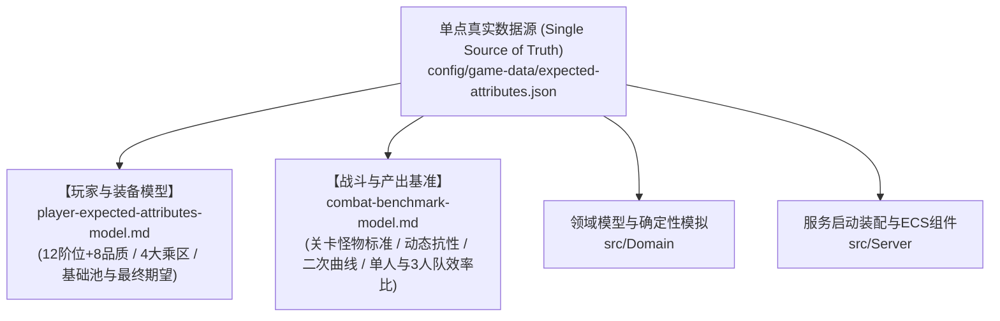

# 游戏数据配置与数值规约架构

## 1. 目录结构与权威源

正式游戏数据位于 `config/game-data`，运行时以 JSON 为唯一权威源（Single Source of Truth）：

- **`expected-attributes.json`**：**全境界阶位数值底座、标准期望面板、特殊属性与战斗模拟产出基准**。
- `manifest.json`：结构版本和内容版本。
- `items/`：物品、消耗品、丹药、秘籍与残卷（`materials.json`, `pills.json`, `manuals.json`）。
- `equipment/`：武器、防具与饰品（`weapons.json`, `armors.json`, `accessories.json`）。
- `abilities/`：物理武技与术法神通（`physical_abilities.json`, `spell_abilities.json`）。
- `monsters/`：各阶位普通妖兽、精英与首领（`tier1_minions.json`, `tier1_elites_bosses.json`, `tier2_minions.json`, `tier2_elites_bosses.json`）。
- `encounters/`：各区域遭遇生态与怪物波次（`tier1_encounters.json`, `tier2_encounters.json`）。
- `maps/`：世界大地图与节点网络（`qingyun_mountain.json`, `xingyun_realm.json`）。
- `actions/`：玩家修炼、采集、精炼、炼丹、锻造与历练行动（`cultivation.json`, `gathering.json`, `crafting.json`, `alchemy.json`, `forging.json`, `combat.json`, `world.json`）。

服务启动时会一次性加载并校验全部文件，再构建不可变目录快照。事件结算不读取磁盘。任意重复 ID、未知引用、非法掉落概率、无效地图连线或不兼容结构版本都会阻止启动。

---

## 2. 顶层设计与数值规约文档拓扑



- **玩家期望属性与装备预算模型**：详见 [`player-expected-attributes-model.md`](./player-expected-attributes-model.md)；
- **战斗基准模拟与产出期望模型**：详见 [`combat-benchmark-model.md`](./combat-benchmark-model.md)；
- **前端公共组件与模板规范**：详见 [`common-components.md`](../frontend/common-components.md)。

---

## 3. 战斗节奏与属性规则

当前标准战斗节奏为：
- 波次间寻敌耗时以当前遭遇的 `respawnMilliseconds` 为基数（默认 5.0 秒，随阶位二次曲线削减至 2.5 秒），按寻敌速度属性以 `基数 / (1 + 寻敌速度加成)` 缩减，并夹取到下限 1s、上限 60s；
- `searchMilliseconds` 默认 20s，仅用于首次入场相位与战斗展示拆分，不参与波次间寻敌缩减；
- `playerRespawnMilliseconds` 为玩家死亡后的 180 秒复活时间。玩家死亡不会完成当前波次，只有当前波怪物全灭才计入一次战斗通关。

配表全面采用**极简 JSON 缺省风格**：未启用的特殊属性或未调整的数值字段无需显式写 `0`，由底层解析器（如 `CharacterStatResolver` / `DataBudgetResolver`）统一赋予确定性的默认值（如 `0.0` 或基础倍率 `1.0`）。服务端不会把缺省或零值解释成隐藏效果，客户端也不会显示零值特殊属性。

---

## 4. 行动收益声明（`yields`）

`actions/` 下的行动通过 `yields` 数组逐项声明产出收益。**收益类型与行动类别（`type`）完全解耦**：修炼行动可以产出灵力或 Buff，采集行动也可以产出修为或经验；同一行动允许声明多条收益。旧字段 `qiPerSecond`、`experiencePerRepeat`、`outputs` 已废弃，不存在类别默认收益。

```json
"yields": [
  { "kind": "qi", "per": "second", "amount": 1 },
  { "kind": "mana", "per": "repeat", "amount": 1 },
  { "kind": "experience", "per": "repeat", "amount": 10 },
  { "kind": "item", "per": "repeat", "id": "item.ningxue-grass", "amount": 3 },
  { "kind": "buff", "per": "repeat", "id": "buff.x", "name": "凝神", "amount": 1,
    "durationSeconds": 60, "modifiers": { "hpRegen": 2 } }
]
```

- `kind`：`qi`（修为）｜`mana`（灵力，入账 `Combat.Manapoints`）｜`hitpoints`（气血）｜`experience`（历练经验）｜`item`（物品）｜`buff`（增益授权）。
- `per`：`second`（按推进整秒逐秒结算，离线与在线位级一致）｜`repeat`（单轮完成时结算）。`item` 与 `buff` 仅允许 `repeat`。
- `amount`：正有限数；`buff` 的 `amount` 表示叠加层数。
- `item` 需携带合法 `id`；`buff` 需携带 `id`、`name`、`durationSeconds`（>0）与可选 `modifiers`（`hpRegen`/`mpRegen`/`attackSpeedRatio`/`damageAbsorptionRatio`）。资源类收益禁止携带实体标识字段。
- 灵力与气血收益按当前属性上限截断；持续消耗品倍率作用于数值型收益，Buff 授权不受影响。
- 输入材料仍由 `inputs` 声明，在单轮完成时扣除。

---

## 5. 版本与发布

修改任何游戏数据时必须同步提升 `manifest.json` 的 `contentVersion`，并运行：

```bash
dotnet run --project src/DataTool/DataTool.csproj -- \
  validate config/game-data
scripts/verify.sh
```

`/healthz` 和 `/readyz` 会返回内容版本与配置指纹。发布系统应把镜像版本、Git revision、游戏数据版本和配置指纹作为同一批次审计。

---

## 6. 角色表现

角色与怪物使用统一的表现描述：

```json
{
  "renderer": "text",
  "source": "修",
  "poster": null
}
```

- `text`：直接显示文本。
- `image`：`source` 为图片 URL 或同源静态资源路径。
- `live2d`、`model3d`：为后续渲染器保留；当前客户端优先显示 `poster`，没有海报时回退到文本。

协议只传渲染器类型与资源地址，不把 Live2D 或 3D 引擎对象写入领域模型。
