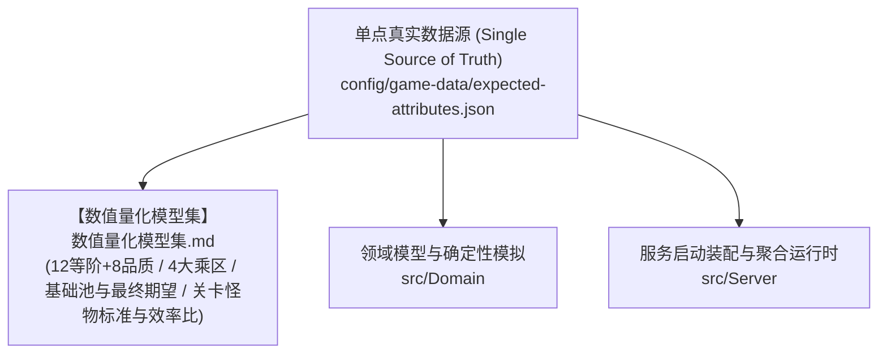

# 游戏数据配置与数值规约架构

## 1. 目录结构与权威源

正式游戏数据位于 `config/game-data`，运行时以 JSON 为唯一权威源（Single Source of Truth）：

- **`expected-attributes.json`**：**全 12 等阶（T1~T12）数值底座、标准期望面板、特殊属性与战斗模拟产出基准**。
- `manifest.json`：结构版本和内容版本。
- `items/`：物品、消耗品、丹药、秘籍与残卷（`materials.json`, `pills.json`, `manuals.json`）。物品分类为两级模型：必填 `category` 是一级主类型（`material`/`consumable`/`manual`/`currency`/`equipment` 等），可选 `subCategory` 是二级细分品类（`herb`/`mineral`/`pill`/`alchemySupply`/`explorationSupply`/`manualTome`/`manualFragment` 等）；目录 DTO 原样下发两个字段，前端品类丝带与坊市二级筛选统一按 `subCategory`（缺省回落主类型，见 `ItemDefinition.DisplaySubCategory`）展示，药品栏门控按细分键 `pill` 判定。
- `equipment/`：武器、防具与饰品（`weapons.json`, `armors.json`, `accessories.json`）。
- `abilities/`：物理武技与术法神通（`physical_abilities.json`, `spell_abilities.json`）。
- `monsters/`：各等阶妖兽、精英与妖王（`tier1_minions.json`, `tier1_elites_bosses.json`, `tier2_minions.json`, `tier2_elites_bosses.json`）。
- `encounters/`：各区域遭遇生态与怪物波次（`tier1_encounters.json`, `tier2_encounters.json`）。
- `maps/`：世界大地图与节点网络（`qingyun_mountain.json`, `xingyun_realm.json`）。
- `buildings/`：玩家可建造的节点公共建筑定义（`buildings.json`：分组、每级效果 `modifiers`、材料清单与解锁境界）。
- `actions/`：玩家修炼、采集、精炼、炼丹、锻造与历练行动（`cultivation.json`, `gathering.json`, `crafting.json`, `alchemy.json`, `forging.json`, `combat.json`, `world.json`）。
- `duel.json`：斗法（PVP）数值唯一真源（匹配窗口、冷却、收益加成等，详见本文 §7）。

服务启动时经 `GameDataCatalog.LoadEmbedded` 一次性加载内嵌资源中的全部文件并构建不可变目录快照，结算不读取磁盘。当前校验强度分三类如实记录：

- **阻止启动**：不兼容的结构版本、必需字段缺失或非法（如空 id、空怪物池、非正耗时/预算）、无效的 `type`/`kind`/`per` 枚举；
- **静默处理（不报错）**：重复 ID 后者覆盖前者、地图邻接表追加不去重；
- **尚未校验**：`dropChance`/`minQuantity`/`maxQuantity` 无范围校验，`eliteEnemyIds`/`bossEnemyIds` 未做跨文件引用校验。配表评审须人工核对这两类风险。

> `DataTool validate --strict` 另做结构性校验：建筑 `group` 合法性、`materials[].itemId` 物品引用与数量为正、节点 `buildableList` 建筑引用与 `buildableTemplate` 模板名（`all`/`production`/`combat`/`other`）、节点 `encounterIds`/`availableActionIds` 跨文件引用、边端点节点引用、建筑 `availableNodeIds` 节点引用，以及行动 `type`/`technique` 词汇表、`combatEncounterId` 遭遇引用、`availableNodeIds`/`excludedNodeIds` 节点引用与两者互斥。

---

## 2. 顶层设计与数值规约文档拓扑



- **玩家期望属性、装备预算与战斗产出基准模型**：详见 [`数值量化模型集.md`](../design/总纲/11-数值量化模型集.md)；
- **前端公共组件与模板规范**：详见 [`common-components.md`](../frontend/common-components.md)。

---

## 3. 战斗节奏与属性规则

当前标准战斗节奏为：
- `searchMilliseconds`：历练**首次搜寻**读条时长，默认 20000ms（20.0 秒）。首搜是防「反复启停行动刷场」的固定读条，**不吃寻敌速度成长乘区**，字段原样消费；
- `respawnMilliseconds`：波次间**再搜寻**耗时，默认 5000ms（5.0 秒）。结算时乘以玩家寻敌速度成长乘区 `SearchDelayFactor = 1 - 0.5·x²`（x 为境界成长进度，曲线见 `CombatGrowthCurve.CastTimeFactor`，前期衰减趋近于零）；
- `playerRespawnMilliseconds`：玩家方团灭后的复活读条时长，默认 180000ms（180 秒）。语义由 `onPartyWipe` 决定：`respawn` 时为战斗内原地起身读条，`defeat` 时为拆场复活点读条。玩家死亡不会完成当前波次，只有当前波怪物全灭才计入一次战斗通关；
- `onPartyWipe`：团灭分流规则枚举，`"respawn"`（原地复活续战）或 `"defeat"`（团灭即败终局），缺省 `respawn`；规则细则见 [战斗规约 §7.9.4](../design/总纲/07-战斗数值与内视规约.md#794-团灭分流规约原地复活-vs-团灭即败)。

技能灵力消耗以 `manaCost` 字段直接点数声明（如 `manaCost: 10` 即消耗 10 点灵力），不再使用比例换算字段。

配表全面采用**极简 JSON 缺省风格**：未启用的特殊属性或未调整的数值字段无需显式写 `0`，由 `GameDataCatalog` 解析器统一赋予确定性的默认值（如 `0.0` 或基础倍率 `1.0`）。服务端不会把缺省或零值解释成隐藏效果，客户端也不会显示零值特殊属性。

---

## 4. 行动收益声明（`yields`）

`actions/` 下的行动通过 `yields` 数组逐项声明产出收益。**收益类型与行动类别（`type`）完全解耦**：修炼行动可以产出灵力或 Buff，采集行动也可以产出修为或经验；同一行动允许声明多条收益。旧字段 `qiPerSecond`、`experiencePerRepeat`、`outputs` 已废弃，不存在类别默认收益。

```json
"yields": [
  { "kind": "qi", "per": "second", "amount": 1 },
  { "kind": "mana", "per": "repeat", "amount": 1 },
  { "kind": "experience", "per": "repeat", "amount": 10 },
  { "kind": "item", "per": "repeat", "id": "item.ningxue-grass", "amount": 3 },
  { "kind": "buff", "per": "repeat", "id": "buff.x", "name": "凝神", "amount": 1,
    "durationSeconds": 60, "modifiers": { "hpRegen": 2 } }
]
```

- `kind`：`qi`（修为）｜`mana`（灵力，入账 `Combat.Manapoints`）｜`hitpoints`（气血）｜`experience`（历练经验）｜`item`（物品）｜`buff`（增益授权）。
- `per`：`second`（按推进整秒逐秒结算，离线与在线位级一致）｜`repeat`（单轮完成时结算）。`item` 与 `buff` 仅允许 `repeat`。
- `amount`：正有限数；`buff` 的 `amount` 表示叠加层数。
- `item` 需携带合法 `id`；`buff` 需携带 `id`、`name`、`durationSeconds`（>0）与可选 `modifiers`（`hpRegen`/`mpRegen`/`attackSpeedRatio`/`damageAbsorptionRatio`）。资源类收益禁止携带实体标识字段。
- 灵力与气血收益按当前属性上限截断；持续消耗品倍率作用于数值型收益，Buff 授权不受影响。
- 输入材料仍由 `inputs` 声明，在单轮完成时扣除。

---

## 5. 版本与发布

修改任何游戏数据时必须同步提升 `manifest.json` 的 `contentVersion`，并运行：

```bash
dotnet run --project src/DataTool/DataTool.csproj -- \
  validate config/game-data
scripts/verify.sh
```

`/healthz`/`/readyz` 只返回存活与依赖就绪状态，不携带配置指纹；内容版本与游戏数据指纹由 `/api/v1/meta` 及各 `/api/v1/catalog/*` 端点的 `ETag` 提供。发布系统应把镜像版本、Git revision、游戏数据版本和配置指纹作为同一批次审计。

---

## 6. 角色表现

角色与怪物使用统一的表现描述：

```json
{
  "renderer": "text",
  "source": "修",
  "poster": null
}
```

- `text`：直接显示文本。
- `image`：`source` 为图片 URL 或同源静态资源路径。
- `live2d`、`model3d`：为后续渲染器保留；当前客户端优先显示 `poster`，没有海报时回退到文本。

协议只传渲染器类型与资源地址，不把 Live2D 或 3D 引擎对象写入领域模型。

---

## 7. 斗法与击杀收益配表字段

- `duel.json`（`id = duel.settings`）：`encounterChancePerBattle`（每次进入战斗计数 +1 概率）、`powerBandRatio`（实力匹配 ± 带宽）、`defeatCooldownSeconds`（败北冷却）、`stagedSettleSeconds`（暂存入账延迟）、`stagedBucketSeconds`（暂存批次量化桶长，入账时刻向上取整到桶尾）、`dropChanceBonusPercent`（斗法爆率加成点数）、`maxDuelSeconds`（剧本超时判平）、`maxBattleReports`（战报归档上限）。所有斗法数值以该配表为唯一真源，禁止代码内硬编码。
- 怪物 `monsters/*.json`：击杀收益为单参数 `experience`（缺省 0）——同额经 `CreditExperience` 结算修为三池（`Experience`/`Foundation`/`CombatExperience`），并按六维归属均分入账六维经验。怪物**战斗经验不入配表**，按其 `level` 对应累计修为 `Σ expToNext[1..level-1]` 派生（`RealmProgressionCatalog.CumulativeExpFor(level)`，详见 [总纲第七篇 §7.7.6](../design/总纲/07-战斗数值与内视规约.md)）。
- 功法 `abilities/*.json`：`rootAttribute` 声明六维归属（`stamina`/`intelligence`/`attack`/`defense`/`swordsmanship`/`talisman`）；击杀 `experience` 的六维分配仅由已装备内功（`discipline=internal`）的归属集合调整，未装备内功时六维严格均分（各得 1/6）。

---

## 8. 玩家存档 progression 分段字段

`progression` 分段载荷即 `PlayerProgressionState` 的 JSON 序列化形态（camelCase，落库与 wire 下发同一形状）。字段清单：

| 字段 | 语义 |
| :--- | :--- |
| `realmLevel` | 当前境界等级（1~127） |
| `experience` | 修为：本层突破计量条，`expToNext` 封顶，突破清零 |
| `foundation` | 底蕴：修为满层溢出沉淀池，可兑换修为放大（最高 3 倍），突破不清空（**schema v4 新增**） |
| `combatExperience` | 战斗经验：修为类收益按增幅前基础量等额入账，用于命中/闪避对抗（**schema v4 新增**） |
| `lifetimeExperience` | 总修为：历史修为类收益总量（含满层转底蕴部分），单调递增永不清零（**schema v4 新增**） |
| `completedActions` / `normalKills` / `eliteKills` / `bossKills` / `totalDefeats` / `cultivationSeconds` / `ageSeconds` | 行动与生平计数、道龄 |
| `simulationCarrySeconds` | 连续收益整秒量化进位余数（离线/在线位级一致保障） |

- **schema 版本**：分段载荷版本由 `SectionCodec.CurrentSchemaVersion` 承载——v3 新增斗法分段（`duel`），v4 为 `progression` 追加 `foundation`/`combatExperience`/`lifetimeExperience` 并移除废案字段 `qi`/`lifetimeQi`，v5 为 `settings` 追加 `autoTravelEnabled` 并为行动意图追加 `anchorNodeId` 入队锚点；内测期直接改载荷结构、不做运行时旧档兼容，旧版本本地存档由 `migrations/` 迁移链推进版本标签（`SectionCodec` bump 时 `PostgresSchema.Version` 同步 +1），不可迁移版本经控制台确认后清零。
- **`expToNext` 访问器**：`RealmProgressionCatalog.ExpCapFor(level)` 返回本层修为上限；新增 `CumulativeExpFor(level)` 返回 `Σ expToNext[1..level-1]` 累计修为，专供怪物战斗经验派生（见 §7）。
