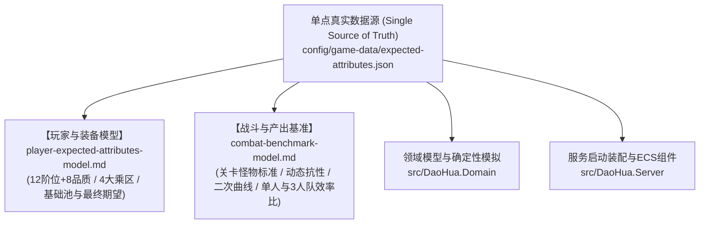

# 游戏数据配置与数值规约架构

## 1. 目录结构与权威源

正式游戏数据位于 `config/game-data`，运行时以 JSON 为唯一权威源（Single Source of Truth）：

- **`expected-attributes.json`**：**全境界阶位数值底座、标准期望面板、特殊属性与战斗模拟产出基准**。
- `manifest.json`：结构版本和内容版本。
- `actions.json`：行动、耗时、输入、输出和可用地点。
- `items.json`：物品、消耗品、恢复、Buff 和使用条件。
- `abilities.json`：技能、消耗、冷却、倍率、控制和特殊效果数值。
- `equipment.json`：装备基础属性和强化成长。
- `monsters.json`：怪物属性、技能引用、掉落和角色表现。
- `encounters.json`：首次寻怪、击杀后重新搜寻、生成权重、首领轮次和玩家复活时间。
- `maps.json`：地图、节点、连线、NPC、建筑、行动入口和节点遭遇池；实际战斗怪物必须从当前节点的 `encounterIds` 选择。

服务启动时会一次性加载并校验全部文件，再构建不可变目录快照。事件结算不读取磁盘。任意重复 ID、未知引用、非法掉落概率、无效地图连线或不兼容结构版本都会阻止启动。

---

## 2. 顶层设计与数值规约文档拓扑



- **玩家期望属性与装备预算模型**：详见 [`player-expected-attributes-model.md`](./player-expected-attributes-model.md)；
- **战斗基准模拟与产出期望模型**：详见 [`combat-benchmark-model.md`](./combat-benchmark-model.md)；
- **前端公共组件与模板规范**：详见 [`common-components.md`](../frontend/common-components.md)。

---

## 3. 战斗节奏与属性规则

当前标准战斗节奏为：
- `searchMilliseconds` 固定 20 秒且不受属性缩减；
- `respawnMilliseconds` 为击败一波怪物后的重新搜寻基线（由 5.0 秒随阶位二次曲线削减至 2.5 秒）；
- `playerRespawnMilliseconds` 为玩家死亡后的 180 秒复活时间。玩家死亡不会完成当前波次，只有当前波怪物全灭才计入一次战斗通关。

怪物与装备会显式保存暴击率、暴击增伤、免暴率和伤害吸收率；未启用的特殊属性也必须写为 `0`。服务端不会把缺省或零值解释成隐藏效果，客户端也不会显示零值特殊属性。

---

## 4. 版本与发布

修改任何游戏数据时必须同步提升 `manifest.json` 的 `contentVersion`，并运行：

```bash
dotnet run --project src/DaoHua.DataTool/DaoHua.DataTool.csproj -- \
  validate config/game-data
scripts/verify.sh
```

`/healthz` 和 `/readyz` 会返回内容版本与配置指纹。发布系统应把镜像版本、Git revision、游戏数据版本和配置指纹作为同一批次审计。

---

## 5. 角色表现

角色与怪物使用统一的表现描述：

```json
{
  "renderer": "text",
  "source": "修",
  "poster": null
}
```

- `text`：直接显示文本。
- `image`：`source` 为图片 URL 或同源静态资源路径。
- `live2d`、`model3d`：为后续渲染器保留；当前客户端优先显示 `poster`，没有海报时回退到文本。

协议只传渲染器类型与资源地址，不把 Live2D 或 3D 引擎对象写入领域模型。
