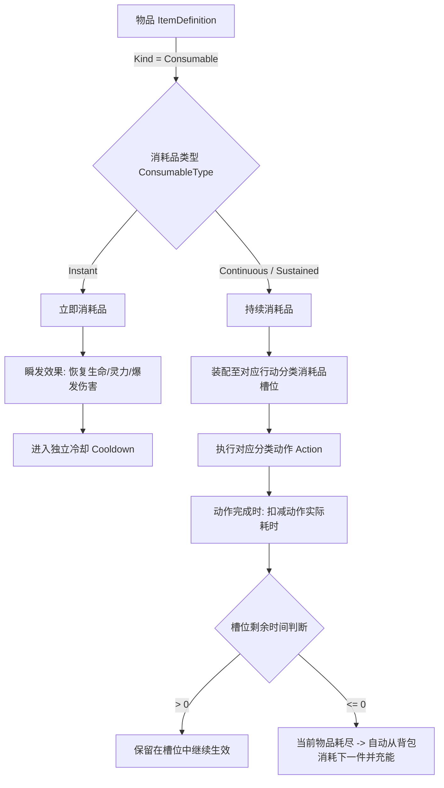

# 道化太初 · 动作耗时分摊持续消耗品机制设计规范

> 本文档正式定义《道化太初》中可使用物品分类（立即消耗品 vs 持续消耗品）、基于动作耗时的持续时间扣除算法、槽位持久化状态、透支结算与切换惩罚规则，以及引气入体与引气丹的数值基线。

---

## 1. 设计背景与核心目标

在传统放置/挂机 RPG 中，消耗品通常采用自然时间流逝的 Buff 计时器（如吃下一枚丹药获得 5 分钟 Buff，无论角色是否在执行修炼，时间都在无情流逝）。这在多任务切换、断续操作或特定动作加速时体验极差，且容易导致玩家心理负担。

《道化太初》建立了一套契合修仙节奏的**动作耗时分摊持续消耗品机制**：
1. **动作绑定与动作耗时消耗**：持续性道具（如引气丹、寻灵香、地火引等）仅在角色**实际执行并完成对应动作**时，按该动作在本次循环中**实际花费的时间**扣减剩余时间。
2. **状态保全**：不切换槽位物品时，剩余持续时间永久保存在槽位中，绝不随自然时间流逝而损失。
3. **透支友好**：当剩余持续时间不足以支付下一次动作时，直接消耗完当前物品，不足的部分免除（玩家小赚一点）。
4. **切换惩罚**：若物品已启用并消耗了部分时间，玩家主动切换/卸下该槽位物品时，直接扣除当前这一件物品且不返还时间，杜绝频繁切槽蹭药。

---

## 2. 消耗品分类与生命周期模型

游戏中所有可使用物品（`ItemKind.Consumable`）严格划分为两类：



### 2.1 立即消耗品 (Instant Consumable)
- **定义**：使用后立即触发瞬时效果（如战斗瞬回气血丹药、回春丹、回灵丹、保命灵符等）。
- **生效方式**：
  - 战斗中根据触发器规则（如生命低于 50%）自动触发，或在支持的场景下手动使用。
  - 使用后直接结算数值（如 `HitpointRestore`、`ManapointRestore`），并让该槽位或该类物品进入独立冷却时间（`CooldownSeconds`）。
- **生命周期**：单次使用立即消耗 1 件物品，无槽位持续时间概念。

### 2.2 持续消耗品 (Continuous / Sustained Consumable)
- **定义**：用于增强特定动作效率或产出的持续性道具（如引气丹、寻灵香、地火引等）。
- **核心属性**：
  - `DurationSeconds`：单件物品提供的总有效动作持续时间（秒，如引气丹为 300 秒）。
  - `UsableInActionTypes`：适用的动作分类集合（如 `ActionType.Cultivation`、`ActionType.Exploration` 等）。
  - `Effects`：直接对该动作结算生效的加成修正（如 `CultivationEfficiencyMultiplier = 1.30`，即增加 30% 修炼效果），**不通过全局 Buff 列表与自然时间计时器流逝**。
  - `Stackable = false`：同一槽位无法叠层，多槽位装配同种物品时按独立槽位依次结算或排他生效。

---

## 3. 槽位状态与动作耗时扣减算法

### 3.1 槽位数据模型扩展

在四大动作分类（修炼 `Cultivation`、探索 `Exploration`、炼丹 `Alchemy`、战斗 `Combat`）的自动消耗品槽位 `AutoUseSlot` 中，增加当前启用物品的持续时间状态：

```csharp
public sealed class AutoUseSlot
{
    /// <summary>装配的物品 ID（为 null 表示空槽）。</summary>
    public string? ItemId { get; set; }

    /// <summary>是否启用该槽位。</summary>
    public bool Enabled { get; set; } = true;

    /// <summary>
    /// 当前已启用的这 1 件物品剩余的有效动作持续时间（秒）。
    /// 数值范围：0.0 <= RemainingDurationSeconds <= ItemDefinition.Consumable.DurationSeconds
    /// 若为 0.0 且槽位启用，下次执行动作时自动从背包消耗 1 件并充能为总时长。
    /// </summary>
    public double RemainingDurationSeconds { get; set; }

    /// <summary>触发条件规则列表（主要供战斗槽位或特殊条件使用）。</summary>
    public List<CombatTrigger>? Triggers { get; set; }
}
```

### 3.2 动作执行与耗时扣减算法 (Deterministic Deduction)

每次动作推进（无论是单步在线模拟还是离线/快进批量补算），遵循严格的确定性流程：

1. **实际动作耗时计算 (Actual Duration)**：
   $$\text{ActualDuration} = \frac{\text{BaseDurationSeconds}}{1.0 + \text{SpeedBonusRatio}}$$
   例如：引气入体基础耗时 10 秒。
   - 若无加成，$\text{ActualDuration} = 10.0$ 秒；
   - 若有加成使速度提高 100%，$\text{ActualDuration} = 5.0$ 秒。

2. **槽位激活与自动充能判定**：
   - 检查对应动作分类下的各个 `AutoUseSlot`：
     - 若槽位已配置 `ItemId` 且 `Enabled == true`：
       - 若 `RemainingDurationSeconds <= 0`：
         - 检查玩家背包 `Inventory` 是否持有该物品且数量 $\ge 1$；
         - 若持有：从背包扣除 1 个物品（`Inventory.Add(ItemId, -1)`），并将槽位 `RemainingDurationSeconds` 充能为该物品的完整 `DurationSeconds`（如 300.0 秒）；
         - 若不持有：槽位无法提供加成，跳过该槽位。
       - 若 `RemainingDurationSeconds > 0`：槽位当前处于激活生效状态。

3. **收益加成结算**：
   - 凡处于激活状态的持续消耗品，将其加成效果（如引气丹 `CultivationEfficiencyMultiplier = 1.30`）直接应用至本次动作的产出计算中：
     $$\text{FinalQi} = \text{BaseQi} \times \prod \text{EfficiencyMultipliers}$$
     $$\text{FinalExp} = \text{BaseExp} \times \prod \text{EfficiencyMultipliers}$$

4. **扣除动作实际耗时与透支处理**：
   - 当本次动作周期**成功完成**时，扣减槽位剩余时间：
     $$\text{NewRemaining} = \text{RemainingDurationSeconds} - \text{ActualDuration}$$
   - **透支免单规则**：
     - 若 $\text{NewRemaining} > 0$：更新 $\text{RemainingDurationSeconds} = \text{NewRemaining}$，物品继续保留在槽位中供下次使用；
     - 若 $\text{NewRemaining} \le 0$：说明这 1 件物品已用尽（即使此前只剩 3 秒，而本次动作花了 5 秒，少掉的 2 秒不再倒扣，直接归零）：
       $$\text{RemainingDurationSeconds} = 0.0$$
       当前物品使命结束。若背包中仍有该物品，下一次动作开始时将自动开启新的一瓶/枚。

### 3.3 切换/卸下槽位惩罚规则 (Switching Penalty)

当玩家向服务端发送修改/切换/卸下槽位指令（如 `SetAutoUseSlot`）时：
- 若目标槽位当前已有物品 $A$，且 $0 < \text{RemainingDurationSeconds} < \text{TotalDurationSeconds}$（即已开封并使用了一部分时间）：
  - 玩家切换为物品 $B$ 或清空槽位时，**已经消耗部分的这 1 件物品 $A$ 不予退回**，其剩余的持续时间直接作废归零。
  - 新装配的物品 $B$ 处于未开封状态（$\text{RemainingDurationSeconds} = 0.0$），在首次触发动作时再从背包扣除 1 件并完整充能。
- **设计目的**：确保游戏经济与时间价值严谨，杜绝玩家在不同动作之间卡毫秒来回切换单个消耗品以获取超额收益。

---

## 4. 引气入体与引气丹数值重构标准

### 4.1 引气入体动作 (`cultivation.draw-qi`)

| 属性 | 原配置 | 新配置标准 | 说明 |
| :--- | :--- | :--- | :--- |
| **动作 ID** | `cultivation.draw-qi` | `cultivation.draw-qi` | 保持稳定强类型 ID |
| **动作名称** | 引气入体 | 引气入体 | 炼气期核心基础吐纳 |
| **基础耗时** | 10 秒 | **10 秒** (`10.0`s) | 确定性动作周期 |
| **基础产出** | 10 灵气 (`resource.qi: 10`) | **10 修为** (`FoundationExp = 10.0`)<br>**1 灵力** (`Qi / Manapoints = 1.0`) | 明确区分修为积累与灵力资源 |
| **执行类型** | `timed` | `timed` | 定时循环动作 |

### 4.2 引气丹道具 (`item.qi-gathering-pill`)

| 属性 | 原配置 | 新配置标准 | 说明 |
| :--- | :--- | :--- | :--- |
| **物品 ID** | `item.qi-gathering-pill` | `item.qi-gathering-pill` | 保持稳定强类型 ID |
| **物品形态** | 消耗品 (`ItemKind.Consumable`) | **持续消耗品** (`ConsumableType.Continuous`) | 动作耗时分摊持续消耗品 |
| **适用动作** | `cultivation` | `cultivation` | 仅在修炼分类动作中生效 |
| **单件总持续时间** | 60 秒 (Buff 形式) | **300 秒** (`DurationSeconds = 300.0`) | 相当于 30 次无加速引气周期 |
| **叠层机制** | 可叠 5 层 | **无法叠层** (`Stackable = false`) | 每次生效固定单件效果 |
| **效果机制** | 全局 BuffState 计时器 | **非 Buff 机制**，槽位即时生效 | 动作结算时直接加成 |
| **数值效果** | 灵气倍率 1.25 | **增加 30% 修炼效果** (`1.30x`) | 修炼获得的修为与灵力均 $\times 1.30$ |
| **单次引气获得 (带引气丹)** | — | **13 修为** ($10 \times 1.30$)<br>**1.3 灵力** ($1 \times 1.30$) | 数值统一 double 精度 |

---

## 5. 前端交互与视觉展示规范

1. **槽位卡片展示**：
   - 消耗品槽位卡片上除了显示装配物品图标、名称与背包余量（如 `×12`）外，增加**启用中物品的剩余时间胶囊/进度条**：
     - 若未开封（未开始扣除）：显示总时长（如 `300s` 或待激活）。
     - 若已开封运行中：显示 `剩余 285s / 300s` 及紧凑型倒计时进度条。
2. **切换二次确认/提示**：
   - 当玩家尝试切换一个正在使用中且剩余时间 $> 0$ 的槽位时，UI 提示：`当前槽位中的 [引气丹] 尚余 180s，切换将直接消耗该物品且不返还剩余时间，是否确认切换？`
3. **公共组件收拢**：
   - 剩余时间显示收拢使用公共 `PillLabel` 或紧凑型进度条组件，严格遵守 `docs/frontend/common-components.md` 规约。

---

## 6. 确定性与离线快进计算契约

在离线挂机和断线重连确定性快进时：
- 计算器根据推进的总动作次数 $N$ 与单次实际动作耗时 $T_{\text{action}}$ 进行批处理推进：
  - 槽位中已有剩余时间 $R$ 最多可供 $K = \lceil R / T_{\text{action}} \rceil$ 次动作消耗。
  - 耗尽后，若背包中有 $M$ 个备用物品，每个物品可提供 $C = \lfloor \text{Duration} / T_{\text{action}} \rfloor$ 次动作（最后一次不足则透支完结）。
  - 无论是逐秒推进还是公式化批处理补算，物品消耗总数与最终获得的修为/灵力完全等价，保证绝对确定性。
