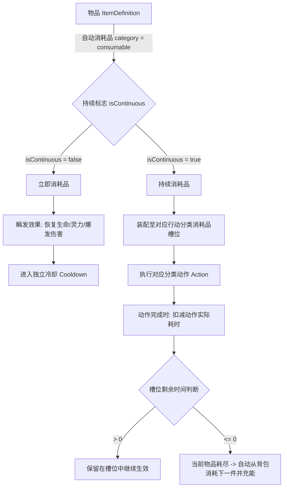

# 第六篇 持续消耗品机制与生活制造体系

> 本文档正式定义《道化太初》中可使用物品分类（立即消耗品 vs 持续消耗品）、基于动作耗时的持续时间扣除算法、槽位持久化状态、透支结算与切换惩罚规则，以及引气入体与引气丹的数值基线。

---

## 6.1 设计背景与核心目标

在传统放置/挂机 RPG 中，消耗品通常采用自然时间流逝的 Buff 计时器（如吃下一枚丹药获得 5 分钟 Buff，无论角色是否在执行修炼，时间都在无情流逝）。这在多任务切换、断续操作或特定动作加速时体验极差，且容易导致玩家心理负担。

《道化太初》建立了一套契合修仙节奏的**动作耗时分摊持续消耗品机制**：
1. **动作绑定与动作耗时消耗**：持续性道具（如引气丹、寻灵香、地火引等）仅在角色**实际执行并完成对应动作**时，按该动作在本次循环中**实际花费的时间**扣减剩余时间。
2. **状态保全**：不切换槽位物品时，剩余持续时间永久保存在槽位中，绝不随自然时间流逝而损失。
3. **透支友好**：当剩余持续时间不足以支付下一次动作时，直接消耗完当前物品，不足的部分免除（玩家小赚一点）。
4. **切换惩罚**：若物品已启用并消耗了部分时间，玩家主动切换/卸下该槽位物品时，直接扣除当前这一件物品且不返还时间，杜绝频繁切槽蹭药。

---

## 6.2 消耗品分类与生命周期模型

游戏中所有可使用物品（`kind: "consumable"`）先按**消耗入口**严格二分，再在自动消耗品内部按 `isContinuous` 字段划分持续/即时：

| 大类 | 消耗入口 | 品类 | 准入键 |
|---|---|---|---|
| **自动消耗品** | 自动使用槽位调度（触发条件 + 扣减时钟），不提供背包手动使用入口 | 丹药、补给、符箓、阵盘等 | `category == "consumable"`，必须配 `consumable` 块 |
| **手动消耗品** | 背包手动使用、即点即结算，各品类走专属权威命令 | 秘籍/残卷（`ability.learn`）、后续宝箱/礼包等 | `category` 为 `manual`/`chest` 等非 `consumable` 值，**不配 `consumable` 块** |

自动消耗品内部按 `isContinuous` 划分两类：



### 6.2.1 立即消耗品 (Instant Consumable)
- **定义**：使用后立即触发瞬时效果（如战斗瞬回气血丹药、回春丹、回灵丹、保命灵符等）。
- **生效方式**：
  - 装配至自动使用槽位后按机制生效：战斗中根据触发器规则（如生命低于 50%）自动触发；**不提供背包手动使用入口**（边界见 §6.2.4）。
  - 使用后直接结算数值（如 `HitpointRestore`、`ManapointRestore`），并让该槽位或该类物品进入独立冷却时间（`CooldownSeconds`）。
- **生命周期**：单次使用立即消耗 1 件物品，无槽位持续时间概念。

### 6.2.2 持续消耗品 (Continuous / Sustained Consumable)
- **定义**：用于增强特定动作效率或产出的持续性道具（如引气丹、寻灵香、地火引等）。
- **核心属性**（字段名对齐实际 JSON schema）：
  - `durationSeconds`：单件物品提供的总有效动作持续时间（秒，如引气丹为 300 秒）。
  - `usableInActionTypes`：物品可装配的**物品栏域**集合（栏域标识见 §6.2.3），决定该物品允许进入哪些自动使用物品栏；某个物品栏只接受声明了本栏域的自动消耗品。
  - 分类加成字段：直接对该动作结算生效的加成修正，按行动大类分别命名——`cultivationMultiplier`（修炼）、`gatheringMultiplier`（探索）、`alchemyMultiplier`（炼丹制造），如引气丹 `cultivationMultiplier = 1.3` 即增加 30% 修炼效果；**不通过全局 Buff 列表与自然时间计时器流逝**。
  - **生效守卫**：物品对运行中行动大类查得的加成倍率 ≤ 1 时，不充能、不扣剩余时长——引气丹可挂在历练栏内，但跑采集行动时不会白烧丹药（倍率字段只对修炼行动生效）。
  - **无叠层**：同一槽位固定单件效果、无法叠层，多槽位装配同种物品时按独立槽位依次结算或排他生效（不引入 `stackable` 字段）。

### 6.2.3 自动使用物品栏：栏域模型与战斗双组栏位

自动使用消耗品按「物品栏域」（`AutoUseBar`）分支——物品栏域独立于行动大类（`ActionKind`），是槽位、物品准入与消耗判定的统一归属键：

| 物品栏域标识 | 覆盖行动 | 槽数 |
| :--- | :--- | :--- |
| `exploration`（历练栏） | 修炼 `Cultivation` 与历练 `Exploration` 两大类全部行动（吐纳修炼、采集、挖掘、探索等非制造行动） | **6** |
| `alchemy` / `forging` / `talisman` / `formation` / `enhancement`（制造技艺栏） | 炼丹制造大类 `Alchemy` 行动按配表 `technique` 字段归属对应栏域（炼丹/炼器/符箓/阵法行动各归其栏）；强化 `Enhancement` 行动归 `enhancement` 栏 | 各 **3** |
| `combat`（战斗栏） | 战斗 `Combat` 行动 | 药品栏 3 + 通用栏 3 |

- **行动 → 栏域映射**：修炼/历练类 → `exploration`；炼丹大类 → 行动 `technique` 同名栏域（配表装载期校验：炼丹大类行动必须声明制造技艺）；强化 → `enhancement`；战斗 → `combat`；赶路无物品栏。
- **物品准入**：`usableInActionTypes` 声明物品允许装配的栏域集合（如引气丹 `["exploration"]`、地火引 `["alchemy"]`）；`queue.auto_use.configure` 服务端权威校验「物品栏域 ∈ 物品声明集合」。
- **消耗判定**：槽位与运行中行动同栏域时才参与结算；持续消耗品再经 §6.2.2 生效守卫过滤无加成场景。

非战斗物品栏内可用消耗品**一律为持续消耗品**，按 §6.3 动作耗时扣减。战斗行动域的消耗品独立成体系，栏位固定为**两组各 3 槽**：

| 栏位组 | 槽数 | 可装配物品 | 消耗语义 |
|---|---|---|---|
| **药品栏** | 3 | 仅限药品类消耗品（`category: pill` 等药品分类） | 使用即消耗：瞬间回复效果（`hitpointRestore`/`manapointRestore`）与回血/回蓝 Buff（`buffs.hpRegen`/`mpRegen`），使用后进入独立冷却 |
| **通用栏** | 3 | 任意自动消耗品：符咒、阵法、特殊道具，**药品亦可放入** | 物品声明直接消耗或持续消耗两种模式 |

**通用栏持续消耗的扣减时钟**——与行动耗时扣减不同源，按战斗状态机判定：

| 战斗状态 | 是否扣减 |
|---|---|
| 战斗进行中（含我方吟唱/敌方出手间隙） | ✅ 扣减 |
| 玩家死亡等待复活（战斗未终结） | ✅ 扣减 |
| 寻敌/遭遇间隙（战斗已结束、下一波未开始） | ❌ 不扣 |
| 退出战斗后 | ❌ 不扣 |

即：持续消耗随"遭遇战存活时钟"走——只要本次遭遇尚未结算离场（含躺尸等待），持续消耗品就持续扣件；寻敌与脱战期间时钟冻结。

持续消耗品可另配 `cooldownSeconds`：时长耗尽时刻起算冷却，冷却未走完时入场不补能（不扣件、不生效）；冷却走完后的下一次入场重新扣件充能（如聚灵阵盘持续 300 秒 / 冷却 300 秒）。非战斗域持续消耗品的冷却在行动起点同样生效，冷却走完后下一次动作起点重新充能。

**使用条件**：战斗消耗品（药品栏与通用栏共用）与技能使用条件共用同一套触发判定模型——对象-类型-比对三元组，见[总纲第七篇 §7.8.3](./07-战斗数值与内视规约.md#783-出手决策顺序与使用条件触发判定)。

### 6.2.4 手动消耗与槽位消耗的边界

全部可使用物品按消耗入口严格二分：

- **自动消耗品**：丹药、符阵等增益/回复类消耗品**不提供手动使用入口**，只能装配至对应行动域的自动使用槽位（§6.2.3），由触发条件与扣减时钟统一调度。放置挂机语境下消耗节奏必须跟随行动时钟与战斗状态机，手动即嗑会绕过冷却与扣减模型。
- **手动消耗品**：技能书/残卷、装备、后续宝箱/礼包类等「即点即结算」物品走背包手动使用——秘籍/残卷走 `ability.learn`，装备走 `loadout.replace`，后续新增品类按各自权威命令分流；不设通用 `item.use` 命令。
- **槽位准入键**：自动使用槽位（含详情页通用物品栏 `SlotGroupGeneral` 与战斗药品栏 `SlotGroupPotion`）的权威校验只接受 `category == "consumable"` 的物品；手动消耗品（`manual`/`chest` 等）即使误配 `usableInActionTypes` 也一律拒绝入槽，前端选择器同口径过滤。
- **`consumable` 块为自动消耗品专属规格**：手动消耗品不配 `consumable` 块（`ItemDefinition.Consumable` 为 null）；凡声明 `consumable` 块的物品必须在 `usableInActionTypes` 中非空声明合法物品栏域（§6.2.3），DataTool 装载期校验拦截「有块无域」与未知栏域的静默死物品。
- **批量消耗原则**：手动消耗品除装备（单件穿戴语义）外默认支持一次消耗多件；批量语义必须与逐次重复严格等价，且在同一权威事务内逐件结算、整体提交或回滚。是否开放批量按使用场景逐类裁定——秘籍/残卷已开放批量研读（见[第五篇 §5.2](./05-技能神通与秘籍残卷体系.md#52-完整技能书与残卷体系-20-种专属道具)），宝箱类落地时按其开袋结算设计决定。

---

## 6.3 槽位状态与动作耗时扣减算法

### 6.3.1 槽位数据模型扩展

在各物品栏域（§6.2.3：历练 `exploration`、制造技艺、战斗 `combat`）的自动消耗品槽位 `AutoUseSlot` 中，增加当前启用物品的持续时间状态：

```csharp
public sealed class AutoUseSlot
{
    /// <summary>装配的物品 ID（为 null 表示空槽）。</summary>
    public string? ItemId { get; set; }

    /// <summary>是否启用该槽位。</summary>
    public bool Enabled { get; set; } = true;

    /// <summary>
    /// 当前已启用的这 1 件物品剩余的有效动作持续时间（秒）。
    /// 数值范围：0.0 <= RemainingDurationSeconds <= ItemDefinition.Consumable.DurationSeconds
    /// 若为 0.0 且槽位启用，下次执行动作时自动从背包消耗 1 件并充能为总时长。
    /// </summary>
    public double RemainingDurationSeconds { get; set; }

    /// <summary>触发条件规则列表（主要供战斗槽位或特殊条件使用；正在落地）。</summary>
    public List<CombatTrigger>? Triggers { get; set; }
}
```

### 6.3.2 动作执行与耗时扣减算法 (Deterministic Deduction)

每次动作推进（无论是单步在线模拟还是离线/快进批量补算），遵循严格的确定性流程：

1. **实际动作耗时计算 (Actual Duration)**：
   $$\text{ActualDuration} = \frac{\text{BaseDurationSeconds}}{1.0 + \text{SpeedBonusRatio}}$$
   （`SpeedBonus` 动作加速加成正在落地；当前无速度加成来源时 $\text{ActualDuration}$ 退化为 `BaseDurationSeconds`。）
   例如：引气入体基础耗时 10 秒。
   - 若无加成，$\text{ActualDuration} = 10.0$ 秒；
   - 若有加成使速度提高 100%，$\text{ActualDuration} = 5.0$ 秒。

2. **槽位激活与自动充能判定**：
   - 检查对应动作分类下的各个 `AutoUseSlot`：
     - 若槽位已配置 `ItemId` 且 `Enabled == true`：
       - 若 `RemainingDurationSeconds <= 0`：
         - 检查玩家资产钱包（`AssetWallet`）是否持有该物品且数量 $\ge 1$；
         - 若持有：从资产中扣除 1 个物品，并将槽位 `RemainingDurationSeconds` 充能为该物品的完整 `durationSeconds`（如 300.0 秒）；
         - 若不持有：槽位无法提供加成，跳过该槽位。
       - 若 `RemainingDurationSeconds > 0`：槽位当前处于激活生效状态。

3. **收益加成结算**：
   - 凡处于激活状态的持续消耗品，将其加成效果（如引气丹 `cultivationMultiplier = 1.3`）直接应用至本次动作的产出计算中：
     $$\text{FinalQi} = \text{BaseQi} \times \prod \text{EfficiencyMultipliers}$$
     $$\text{FinalExp} = \text{BaseExp} \times \prod \text{EfficiencyMultipliers}$$

4. **扣除动作实际耗时与透支处理**：
   - 当本次动作周期**成功完成**时，扣减槽位剩余时间：
     $$\text{NewRemaining} = \text{RemainingDurationSeconds} - \text{ActualDuration}$$
   - **透支免单规则**：
     - 若 $\text{NewRemaining} > 0$：更新 $\text{RemainingDurationSeconds} = \text{NewRemaining}$，物品继续保留在槽位中供下次使用；
     - 若 $\text{NewRemaining} \le 0$：说明这 1 件物品已用尽（即使此前只剩 3 秒，而本次动作花了 5 秒，少掉的 2 秒不再倒扣，直接归零）：
       $$\text{RemainingDurationSeconds} = 0.0$$
       当前物品使命结束。若背包中仍有该物品，下一次动作开始时将自动开启新的一瓶/枚。

### 6.3.3 切换/卸下槽位惩罚规则 (Switching Penalty)

当玩家向服务端发送修改/切换/卸下槽位指令（如 `SetAutoUseSlot`）时：
- 若目标槽位当前已有物品 $A$，且 $0 < \text{RemainingDurationSeconds} < \text{TotalDurationSeconds}$（即已开封并使用了一部分时间）：
  - 玩家切换为物品 $B$ 或清空槽位时，**已经消耗部分的这 1 件物品 $A$ 不予退回**，其剩余的持续时间直接作废归零。
  - 新装配的物品 $B$ 处于未开封状态（$\text{RemainingDurationSeconds} = 0.0$），在首次触发动作时再从背包扣除 1 件并完整充能。
- **设计目的**：确保游戏经济与时间价值严谨，杜绝玩家在不同动作之间卡毫秒来回切换单个消耗品以获取超额收益。

---

## 6.4 引气入体与引气丹数值重构标准

### 6.4.1 引气入体动作 (`cultivation.draw-qi`)

| 属性 | 原配置 | 新配置标准 | 说明 |
| :--- | :--- | :--- | :--- |
| **动作 ID** | `cultivation.draw-qi` | `cultivation.draw-qi` | 保持稳定强类型 ID |
| **动作名称** | 引气入体 | 引气入体 | 炼气期核心基础吐纳 |
| **基础耗时** | 10 秒 | **10 秒** (`10.0`s) | 确定性动作周期 |
| **基础产出** | 10 灵气 (`resource.qi: 10`) | **10 修为** + **10 灵力** | 由行动 `yields` 声明：`experience` 每轮 10、`mana` 每轮 10，单轮完成时一次性入账；修为收益统一经 `CreditExperience` 入账（瓶颈截断/底蕴兑换，打坐修炼等非战斗行动不增加战斗经验） |
| **执行类型** | `timed` | `timed` | 定时循环动作 |

### 6.4.2 引气丹道具 (`item.qi-gathering-pill`)

| 属性 | 原配置 | 新配置标准 | 说明 |
| :--- | :--- | :--- | :--- |
| **物品 ID** | `item.qi-gathering-pill` | `item.qi-gathering-pill` | 保持稳定强类型 ID |
| **物品形态** | 消耗品 (`kind: "consumable"`) | **持续消耗品** (`isContinuous: true`) | 动作耗时分摊持续消耗品 |
| **适用栏域** | `cultivation` | `exploration` | 装配于历练栏（§6.2.3）；`cultivationMultiplier` 仅对修炼大类行动生效，跑其他历练行动时不消耗 |
| **单件总持续时间** | 60 秒 (Buff 形式) | **300 秒** (`durationSeconds = 300.0`) | 相当于 30 次无加速引气周期 |
| **叠层机制** | 可叠 5 层 | **无法叠层**（无叠层字段，固定单件效果） | 每次生效固定单件效果 |
| **效果机制** | 全局 BuffState 计时器 | **非 Buff 机制**，槽位即时生效 | 动作结算时直接加成 |
| **数值效果** | 灵气倍率 1.25 | **增加 30% 修炼效果** (`cultivationMultiplier = 1.3`) | 修炼获得的修为与灵力均 $\times 1.30$ |
| **单次引气获得 (带引气丹)** | — | **13 修为** ($10 \times 1.30$)<br>**13 灵力** ($10 \times 1.30$) | 数值统一 double 精度 |

---

## 6.5 前端交互与视觉展示规范

1. **槽位卡片展示**：
   - 消耗品槽位卡片上除了显示装配物品图标、名称与背包余量（如 `×12`）外，增加**启用中物品的剩余时间胶囊/进度条**：
     - 若未开封（未开始扣除）：显示总时长（如 `300s` 或待激活）。
     - 若已开封运行中：显示 `剩余 285s / 300s` 及紧凑型倒计时进度条。
2. **切换二次确认/提示**：
   - 当玩家尝试切换一个正在使用中且剩余时间 $> 0$ 的槽位时，UI 提示：`当前槽位中的 [引气丹] 尚余 180s，切换将直接消耗该物品且不返还剩余时间，是否确认切换？`
3. **公共组件收拢**：
   - 剩余时间显示收拢使用公共 `PillLabel` 或紧凑型进度条组件，严格遵守 `docs/frontend/common-components.md` 规约。

---

## 6.6 确定性与离线快进计算契约

在离线挂机和断线重连确定性快进时：
- **实际结算形态**：`SimulationEngine.AdvanceTo` 外层循环按 Buff 到期、消耗品冷却与自然回复等边界逐秒切片结算，逐片套用上述耗时扣减与充能规则，而非一次性公式化批处理。
- **结果等价性**：逐秒切片与公式化批处理在数学上完全等价——槽位中已有剩余时间 $R$ 最多可供 $K = \lceil R / T_{\text{action}} \rceil$ 次动作消耗；耗尽后，若资产中仍有 $M$ 个备用物品，每个物品可提供 $C = \lfloor \text{Duration} / T_{\text{action}} \rfloor$ 次动作（最后一次不足则透支完结）。
- 无论是逐秒推进还是离线快进补算，物品消耗总数与最终获得的修为/灵力完全等价，保证绝对确定性。

## 6.7 材料分类体系与丹药配置 (T1~T2 全量)

修仙界全量材料按**产出来源与工艺特性**严格划分为四大独立二级子品类（`subCategory`），彻底解决过去粗粒度归混问题：

1. **灵材 (Spirit Material / `spiritMaterial`, 5种)**：天地灵气自然滋养之草木、古树与灵泉甘露，全部由大世界【采集】（Gathering）行动获取。
   - **T1 (3种)**：凝气草（`item.ningxue-grass`）、桃木（`item.peach-wood`）、晨露（`item.morning-dew`）。
   - **T2 (2种)**：伴灵花（`item.banling-flower`）、引灵松（`item.yinlingsong-wood`）。

2. **矿石 (Mineral / `mineral`, 2种)**：深山地脉与灵矿灵穴蕴藏之原金原石，全部由大世界【挖矿】（Mining）行动获取。
   - **T1 (1种)**：乌铁（`item.dark-iron`，原铁沉矿）。
   - **T2 (1种)**：赤铜（`item.crimson-copper`，灵脉火纹赤铜）。

3. **异材 (Exotic Material / `exoticMaterial`, 12种)**：凶兽异种体内妖煞灵骨、遗骸皮牙与古战场兵火残片，全部由【战斗讨伐】（Combat Drops）掉落。
   - **T1 (5种)**：兽皮（`item.beast-hide`）、兽骨（`item.beast-bone`）、破碎灵核（`item.broken-spirit-core`）、妖丹（`item.demon-dan`）、煞齿（`item.sha-fang`）。
   - **T2 (7种)**：兽牙（`item.beast-fang`）、火羽（`item.fire-feather`）、残魄灵符（`item.soul-talisman`）、残刃（`item.broken-blade`）、煞骨（`item.sha-bone`）、妖核（`item.demon-core`）、陨星破片（`item.meteor-fragment`）。

4. **精材 (Refined Material / `refinedMaterial`, 6种)**：修士借地火鼎炉千锤百炼、精纯萃取而成的中间高阶加工材料，由【生活制造】（炼器精炼 / 炼丹萃取）产出。
   - **T1 (3种)**：
     - **百炼铁** (`item.refined-iron`): 乌铁×3 $\to$ 炼器精炼物理主料；
     - **桃木晶** (`item.peach-wood-crystal`): 桃木×3 $\to$ 炼器精炼术法主料；
     - **草木精华** (`item.herb-essence`): 凝气草×2 + 晨露×1 $\to$ 炼丹萃取基础药露。
   - **T2 (3种)**：
     - **赤铜精** (`item.refined-copper`): 赤铜×3 $\to$ 炼器精炼物理主料；
     - **灵松晶** (`item.spirit-pine-crystal`): 引灵松×3 $\to$ 炼器精炼术法主料；
     - **伴灵精华** (`item.banling-essence`): 伴灵花×2 + 晨露×1 $\to$ 炼丹萃取高阶药露。

- **丹药库 (4种)**：
  - **引气丹** (`item.qi-gathering-pill`): 凝气草×3 | 持续 300s | **+30% 修炼收益**（引气入体 10 Exp $\to$ 13 Exp，10 MP $\to$ 13 MP）
  - **止血散** (`item.zhixue-powder`): 草木精华×1 + 凝气草×1 | Buff 持续 30s / CD 60s | 生命回复 +36 + 5% 伤害吸收（减伤）
  - **顺气丸** (`item.shunqi-pill`): 草木精华×1 + 伴灵花×1 | Buff 持续 30s / CD 60s | 灵力回复 +24 + 5% 行动速度（攻速）
  - **通脉丹** (`item.tongmai-pill`): 伴灵精华×2 + 妖核(Boss)×1 | 持续 300s | **+50% 修炼收益**

---

## 6.8 生活技艺等级与符箓/阵法制品（TASK-20261003-04）

- **七技艺**：炼丹 `alchemy`、炼器 `forging`、符箓 `talisman`、强化 `enhancement`、阵法 `formation`、采集 `gathering`、挖掘 `mining`——独立累计经验，0 级起按修为曲线（`RealmProgressionCatalog.ExpToNext`）逐段升级，每级 +5% 对应行动速度。详见 `20-技艺体系与符箓阵法强化规约.md` §20.1。
- **符箓制品**：雷击符（`item.leiji-talisman`）——战斗通用栏即时打击消耗品（`consumable.strike`），耗 `5%×MaxManapoints`，造成 `20%×MaxMana + 200%×SpellAttack` 木系法术伤害，冷却 60 秒，无吟唱。详见 §20.2。
- **阵法制品**：聚灵阵盘（`item.juling-formation-disk`）——战斗通用栏持续消耗品：持续 300 秒、冷却 300 秒（耗竭时刻起算），每次入场自动消耗 1 件；每 5 秒回蓝 `(原回蓝+5)×1.3`（后段回复乘区 `mpRegenPostRatio`）。详见 §20.3。
- **装备强化**：`enhance.equipment` 行动独立结算（精华+灵石成本、成功率查表+技艺修正、护符保护、±变体迁移），上限 +20。详见 §20.4。
- **行动→技艺映射**：配表 `"technique"` 字段（炼丹/炼器/采集/挖掘/符箓/阵法/强化行动各自绑定）。
