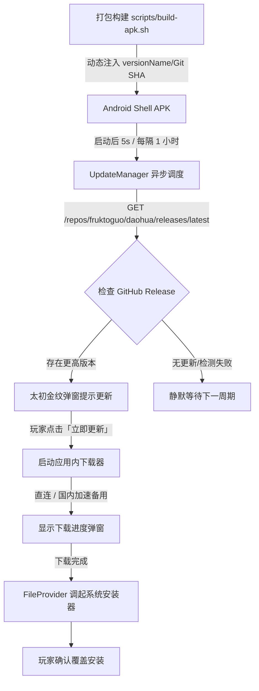

# TASK-20261025-01: Android 客户端每小时自动检测 GitHub 更新与应用内下载安装

## 1. 需求背景与核心目标

目前《道化太初》已支持全自动构建 Android 完全版安装包 (`scripts/build-apk.sh`) 并自动发布到 GitHub Releases (`scripts/upload-release-apk.sh`)。
然而已安装在手机上的 Android 客户端尚无自更新感知能力，当线上发布新版本 APK 时，玩家无法及时知晓或需要手动前往网页下载覆盖，流程割裂。

本任务旨在深度优化打包与 Android 壳工程，赋予打出来的 Android 安装包完整的**自动更新检测、弹窗提醒、应用内多源下载与原生自动安装**能力：
1. **自动周期检测**：客户端启动后以及在运行期间**每隔 1 小时**自动向 GitHub Releases 官方 API 发起异步检测；
2. **版本精准比对**：在打包流水线中自动注入 Git Commit SHA、版本号与构建时间，与 GitHub Release 的最新 Tag 及资产做精准比对；
3. **仙侠韵味更新提示**：发现新版本时弹出太初墨黑/流金风格的更新提示框，展示新版本号与更新说明；具备用户“稍后提醒”24小时冷却防打扰机制；
4. **稳定韧性下载**：应用内显示下载进度条（百分比与大小），优先直连 GitHub，超时/受阻时自动降级国内公共高速加速镜像，保障国内无梯玩家顺畅更新；
5. **平滑系统安装**：Android 7.0+ FileProvider 规范与 Android 8.0+ REQUEST_INSTALL_PACKAGES 权限适配，下载完成后直接调起系统安装器，一键覆盖安装；
6. **前端设置联动**：通过原生 JS 桥接，支持玩家在游戏内设置面板查看当前客户端版本并手动点击「检查更新」。

---

## 2. 核心架构与技术方案

### 2.1 打包流水线版本注入 (`scripts/build-apk.sh`)
- 从当前 Git 环境提取 `GIT_SHA` (`git rev-parse --short=8 HEAD`)；
- 从 `frontend/package.json` 提取 `version`；
- 生成 `app-version.json` 写入 `tools/android-shell/app/src/main/assets/app-version.json` 与 `assets/www/`；
- 通过 Gradle 属性 `-PappVersionName` 与 `-PappVersionCode` 注入到 Android 构建配置中。

### 2.2 原生更新管理器 (`UpdateManager.java`)
- 单线程调度器 (`ScheduledExecutorService`)：延迟 5 秒初检，每 3600 秒（1小时）静默轮询；
- 请求 GitHub API：`https://api.github.com/repos/fruktoguo/daohua/releases/latest`；
- 解析 Release `tag_name`、`body` 与 `assets` 中的 `daohua.apk` 下载链接；
- 网络异常自动捕获并静默抑制，绝不影响主游戏 WebView 渲染与操作。

### 2.3 下载与系统安装器调用
- [X] **子任务 1：Android 壳工程权限与 FileProvider 配置**
  - 在 `AndroidManifest.xml` 中增加 `REQUEST_INSTALL_PACKAGES` 权限；
  - 声明原生内部轻量 `AppFileProvider` 及 `res/xml/file_paths.xml`，保证免第三方依赖秒级编译。
- [X] **子任务 2：实现 UpdateManager 核心类**
  - 版本检测、GitHub Release API 解析、定时 1 小时调度与防骚扰冷却（24h 稍后提醒）；
  - 仙侠风格的更新提示弹窗与可交互进度条弹窗；
  - 多源下载支持（GitHub 官方直连 + 国内公共反代镜像节点自动加速降级）；
  - 下载完成自动调起系统安装器与未知来源权限引导。
- [X] **子任务 3：MainActivity 与 JSBridge 桥接集成**
  - 在 `MainActivity` 启动生命周期接入 `UpdateManager`；
  - 暴露 `DaoHuaNative` 供 WebView 前端调用版本信息与手动检查更新。
- [X] **子任务 4：打包脚本 `build-apk.sh` 优化与动态版本注入**
  - 注入 Git SHA、Package Version 与构建时间戳到 `app-version.json` 和 Gradle 参数；
  - 支持本地编译验证并确保产物版本号对齐。
- [X] **子任务 5：全量门禁与端到端编译验证**
  - 运行 i18n 覆盖、日志标记、前端单测与 Release 构建；
  - 实际运行 `build-apk.sh` 成功编译输出 2.1MB 的 `artifacts/daohua.apk`，验证 dex 中包含更新核心类且 assets 中内嵌完整指纹。

---

## 4. 时间节点与过程日志

- `2026-10-25 10:15:00`：用户提出优化打包与 Android 安装包每小时自动检测 GitHub 更新并下载安装需求。完成需求深度剖析与方案设计，建立本任务文档与主看板登记。
- `2026-10-25 10:45:00`：完成 Android 原生 UpdateManager、AppFileProvider、MainActivity 桥接、前端关于面板联动及 build-apk.sh 版本指纹动态注入；完成 APK 打包与全量测试验证，任务状态变更为「已完成」。
